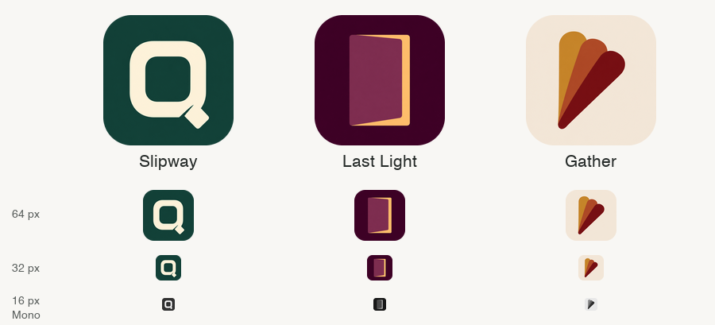

# QuickClose · Quiet Exit

Three independent GPT Imagegen concepts, made on 2026-11-26 without prior icon artwork as input. Each original is a full-bleed 1254 × 1254 PNG. These are identity studies for the app, separate from the menu-bar status symbol.

**Selected direction:** [Slipway in slate and peach](slipway-slate-peach.png). The sRGB artwork uses `#232A2E` for the background and `#E69875` for the Q. It uses the same edge mask as the [earlier graphite version](slipway-graphite-peach.png).

**Recommendation: [Slipway](01-slipway.png).** The ivory Q stands for both QuickClose and the familiar Mac Quit shortcut. Its squared bowl suggests an app tile, and a small piece slips away from the corner. The counter and projecting tail still read at 32 px. At 16 px in grayscale the notch is no longer distinct, but the Q survives. Keep the tail short: extending it could make the mark look like Search.

**[Last Light](02-last-light.png)** shows a plum door with a strip of warm light at its edge. It is the quietest emotional interpretation. At 32 px the bright jamb survives, but the hinge direction is hard to see. A door could also suggest logging out.

**[Gather](03-gather.png)** folds three blades into one fan. The staggered tips make a strong silhouette at 32 px. Without the name, the color fan could also suggest a palette app; the interior planes are harder to distinguish in the 16 px grayscale preview.

## Research that changed the design

- [Apple’s Mac User Guide: Quit apps](https://support.apple.com/guide/mac-help/quit-apps-mchl834d18c2/mac) distinguishes quitting an app with Command-Q from closing its window. QuickClose’s primary action requests a normal quit for the selected apps. This is why the Q is a better literal cue than a red close button. It references the system convention, not QuickClose’s bulk-action shortcut.
- [Apple HIG: App icons](https://developer.apple.com/design/human-interface-guidelines/app-icons), consulted through HIG MCP, recommends a distinctive central idea, simple backgrounds, and recognizable shapes across sizes and appearances. Each study has one main silhouette.
- [WWDC25: Say hello to the new look of app icons, 5:18 onward](https://developer.apple.com/videos/play/wwdc2025/220/?time=318) explains how system lighting adds detail and why bold shapes hold up better than thin lines. None of these concepts depends on a highlight to explain the form.
- [W3C cognitive accessibility: Use icons that help the user](https://www.w3.org/TR/coga-usable/#use-icons-that-help-the-user-pattern) recommends familiar cues with a single meaning. This informed the emphasis on recognition. It is guidance for web content, not evidence from testing these designs with people with ADHD.

## What was checked

The three originals were decoded and downsampled with Lanczos filtering. The board shows a common rounded preview mask and matching 64 px, 32 px, and grayscale 16 px renders. These are optical checks of the concepts, not captures from Finder or system-rendered Icon Composer appearances. The mask belongs only to the preview. For production, redraw the selected mark as a clean vector on Apple’s 1024 px grid and check it in Icon Composer before replacing the shipped icon.
