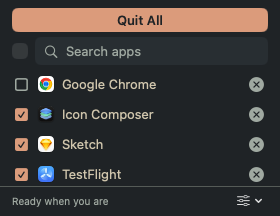
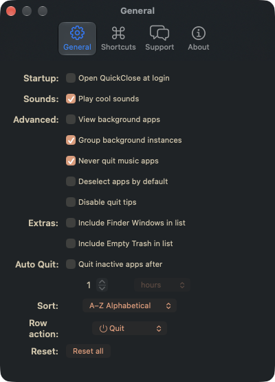

# QuickClose

**Quit the apps you’re done with. Keep the ones you need.** QuickClose puts your running Mac apps in one menu-bar list. When you finish a project, you can quit its tools together and leave your browser and music open.

**[Download QuickClose for Mac](https://github.com/withLinda/QuickClose/releases/latest/download/QuickClose.dmg)** · macOS 15 or later · Apple silicon and Intel

## Your first cleanup

1. **Install QuickClose.** Open the downloaded DMG, drag **QuickClose** to **Applications**, then open it from there.
2. **Choose what stays open.** Click the **power icon** in the menu bar. Uncheck any app you want to keep. Use **Search apps** to narrow the list.
3. **Quit the rest.** Click **Quit All** or press **⌘⌥Q** with the panel open. Only checked apps in the current list get a quit request. To quit just one app, click the **×** on its row.

**Quit All** gives each app a chance to ask you to save. If one stays open, check it for a save prompt. A separate **Force Quit** button targets only apps from that attempt that are still checked and visible. Force quitting can discard unsaved changes.

## Make it fit your routine

Open the **sliders menu** at the bottom right of the panel and choose **Settings → General**.

- **Keep the music playing.** Apple Music, Spotify, and other supported players are protected by default. A lock marks them in the list.
- **Choose apps yourself.** Turn on **Deselect apps by default** to start with nothing checked. Sort by name or by most recently launched.
- **Quit inactive apps.** Set a timer in minutes or hours. QuickClose requests a normal quit for selected apps you haven’t brought to the front. It skips the app you’re using and background apps.
- **See background apps.** Show them when you need them, and group multiple instances of the same app into one row.
- **Tidy Finder too.** Add separate actions to close Finder windows or empty the Trash. Emptying the Trash asks for confirmation.
- **Set your defaults.** Open QuickClose at login, toggle the quit sound, or set **Row action** to **Force Quit** for individual apps. Bulk and automatic quits always ask apps to close normally.

